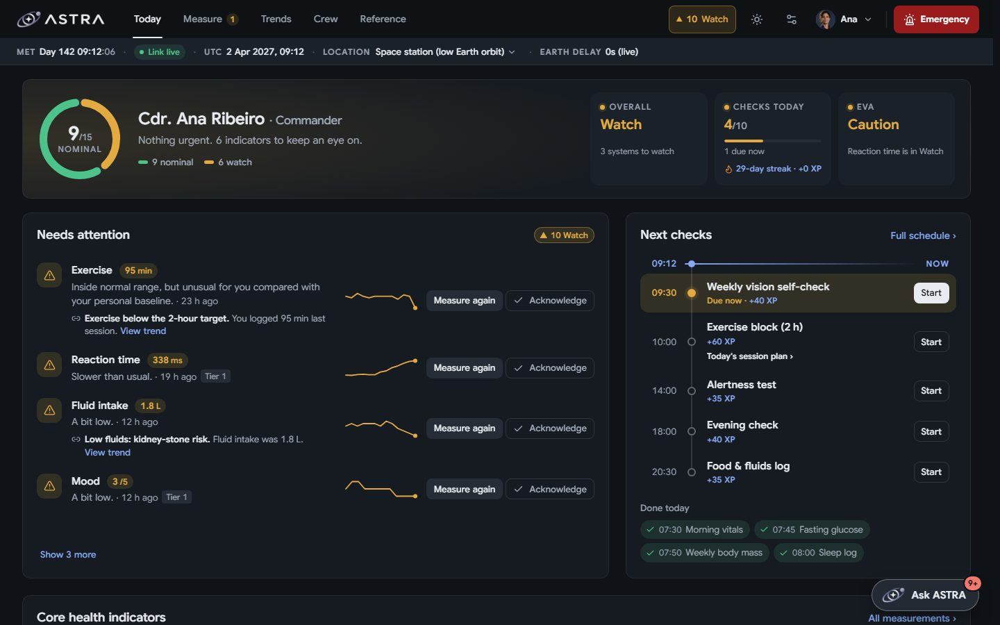
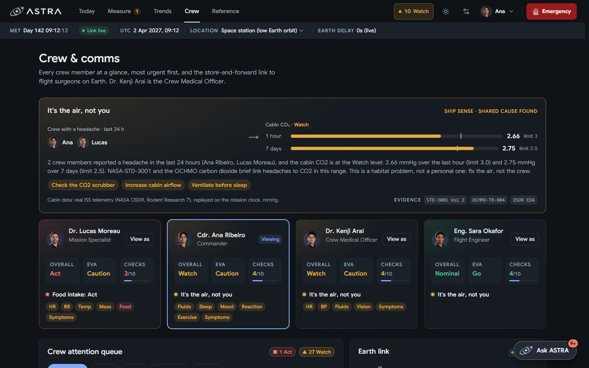
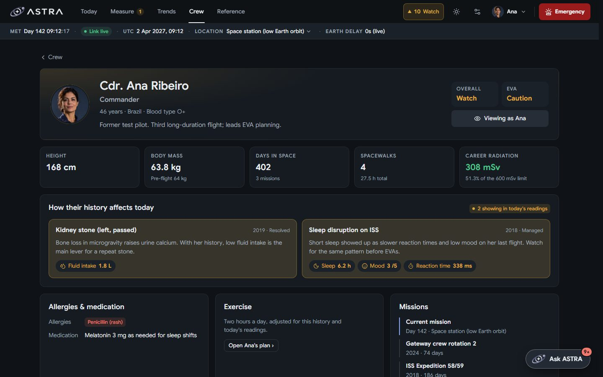
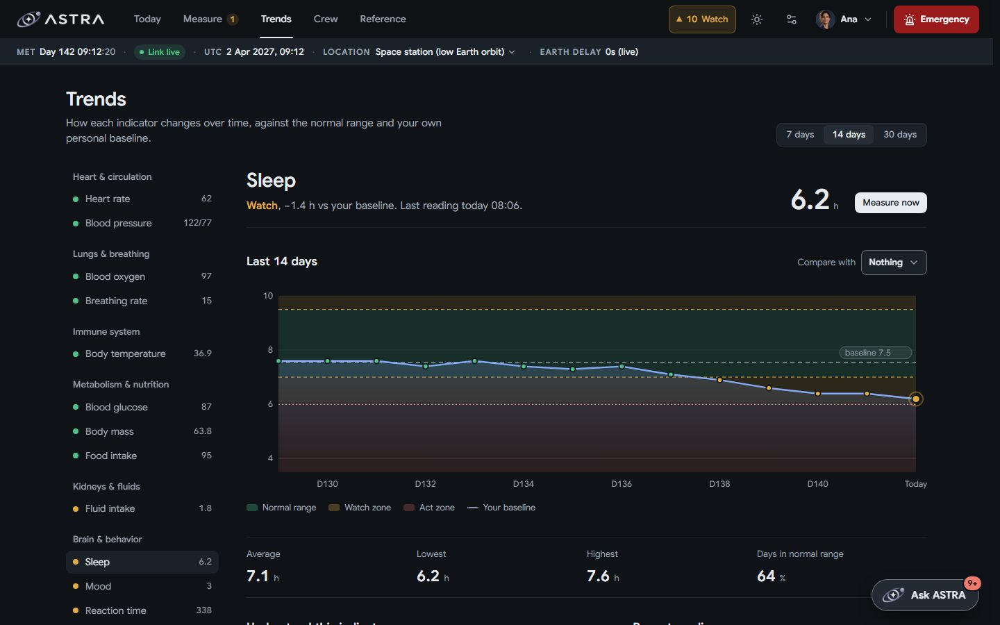
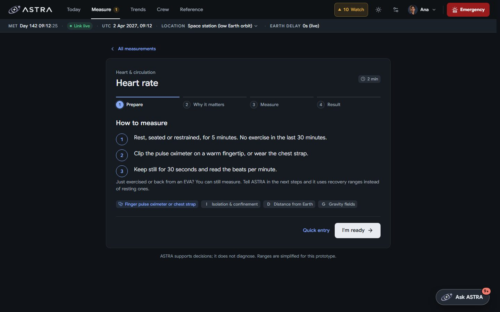
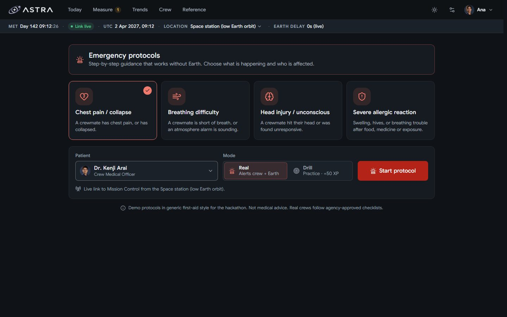
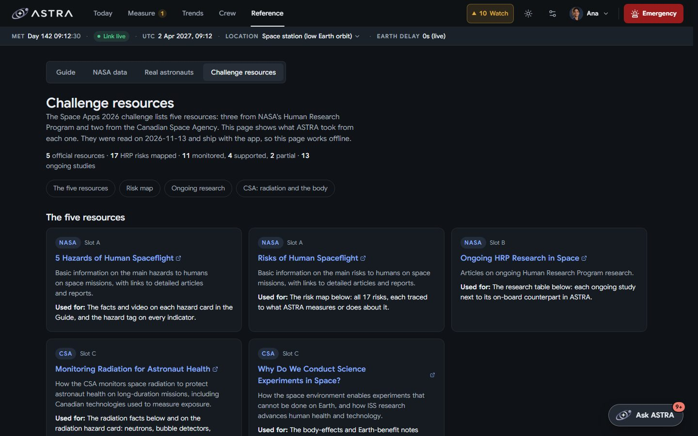
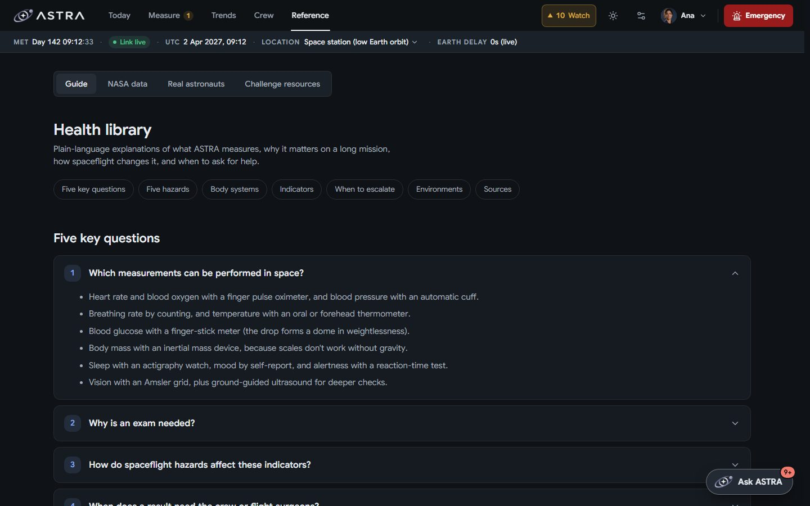
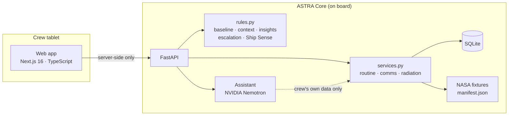

<div align="center">

<picture>
  <source media="(prefers-color-scheme: dark)" srcset="web/public/logo-wordmark-dark.png" />
  
</picture>

### Astronaut Self-Triage & Readiness Assistant

**Health monitoring that lives on board and never waits for Earth.**

[](https://www.spaceappschallenge.org/2026/challenges/health-monitoring-software/)
[](engine/)
[](engine/)
[](web/)
[](engine/tests/)
[](#real-nasa-data-shipped-on-board)

[**Watch the 4-minute film**](https://www.youtube.com/watch?v=bbZLEXe4MnQ) ·
[Quick start](#quick-start) ·
[How it works](#how-astra-works) ·
[NASA data](#real-nasa-data-shipped-on-board) ·
[Challenge resources](#all-five-official-challenge-resources)

<a href="https://www.youtube.com/watch?v=bbZLEXe4MnQ">
  
</a>

</div>

---

## Why ASTRA exists

On the International Space Station a doctor is one call away. On the way to Mars, a message to Earth takes **up to
22 minutes each way**, and when the Sun passes between the planets there is **no link at all** for about two
weeks. Meanwhile NASA's five hazards of human spaceflight (**R**adiation, **I**solation, **D**istance, **G**ravity
and a hostile closed **E**nvironment) keep changing the body: weight-bearing bones can lose up to 1.5% of their
mass every month.

NASA calls the answer *Earth-independent medical operations*. The crew has to be its own first responder, and not
every astronaut is a doctor.

ASTRA is our answer to the NASA Space Apps Challenge 2026,
[*Create Health Monitoring Software for Astronauts on Space Missions*](https://www.spaceappschallenge.org/2026/challenges/health-monitoring-software/).
It helps each astronaut **gather** health indicators, **evaluate** them against NASA limits *and their own body*,
and **act** with clear guidance, all without waiting for Earth.

> [!NOTE]
> ASTRA is a decision-support prototype, not a medical device. The crew, the mission (MERIDIAN-1) and their medical
> histories are fictional. The environment data (signal delay, cabin air, radiation, solar storms, astronaut blood
> panels) is **real NASA data**, and every threshold cites the NASA document it comes from.

---

## How ASTRA works

<table>
<tr>
<td width="33%" valign="top">

### 1 · Gather

**14 health indicators** plus a daily symptom check: heart rate, blood pressure, SpO₂, breathing rate,
temperature, blood glucose, hydration, body mass, nutrition, sleep, mood, reaction time (tap test), vision
(Amsler grid for SANS) and exercise.

A daily **routine** prompts each check at the right time. Every measurement explains *how* to take it and *why*
it matters in space.

</td>
<td width="33%" valign="top">

### 2 · Evaluate

A deterministic, tested **rules engine** grades every reading **Nominal · Watch · Act** against NASA ranges
**and** the astronaut's own baseline.

It knows the person: their **past diagnoses**, the **context** of a reading (rest vs. after exercise or an
EVA), and how readings across the crew and the cabin relate to each other.

</td>
<td width="33%" valign="top">

### 3 · Act

Plain-language guidance for every result, an **escalation ladder** (self-care → Crew Medical Officer → flight
surgeon), **delay-aware messages** to Earth with live reply countdowns, and **four offline emergency
protocols**, including CPR in microgravity.

</td>
</tr>
</table>

### An engine that knows the person

| | What it does | Example |
|---|---|---|
| **Personal baseline** | Each reading is compared with the astronaut's own history (z-score), not just a population range | A heart rate that is normal for most people but high *for you* becomes **Watch** |
| **Medical history** | Every past diagnosis names the indicators it makes likely to drift, and why | Ana's 2019 kidney stone puts **hydration** under closer watch; Kenji's borderline BP drives **BP trends**; a repaired knee changes how exercises are loaded |
| **Readings in context** | Heart rate, BP and breathing are graded for rest, waking, after exercise or after an EVA | 125 bpm ten minutes after a workout is expected; post-exertion readings never pollute the baseline |
| **Insights** | Related readings are joined into one finding instead of five alarms | *Sleep-debt pattern*, *early infection*, *BP drift*, *possible SANS sign*, *deconditioning*, *kidney-stone risk*, *weight loss* |
| **Ship Sense** | When two or more crew report the **same symptom**, ASTRA checks the ship before the patients | Two headaches + real ISS cabin CO₂ above the NASA limit → **"It's the air, not you"**, and what to fix |
| **Escalation** | Persistence rules decide who needs to know | Self-care → Crew Medical Officer → flight surgeon, queued for the comms window |

### AI that explains, rules that decide

Every alert comes from the tested rules engine, so every alert is explainable and repeatable. On top of it, an
onboard assistant built on **NVIDIA Nemotron** (via NVIDIA NIM) answers crew questions **only from that crew's own
readings, history and alerts**. It never raises or clears an alert. If the model is unavailable, rule-based answers
reply instead.

---

## A tour

<table>
<tr>
<td width="50%"><br/><b>Today</b>: readiness score, what needs attention and the checks due next.</td>
<td width="50%"><br/><b>Crew & comms</b>: Ship Sense links two headaches to real ISS cabin CO₂.</td>
</tr>
<tr>
<td><br/><b>Crew profile</b>: how each past diagnosis affects today's readings.</td>
<td><br/><b>Trends</b>: 7/14/30 days, status zones and the personal baseline.</td>
</tr>
<tr>
<td><br/><b>Measure</b>: how → why it matters in space → measure → result.</td>
<td><br/><b>Emergency</b>: four step-by-step protocols that run fully offline, with drills.</td>
</tr>
<tr>
<td><br/><b>Challenge resources</b>: all 17 NASA risks mapped to what ASTRA does.</td>
<td><br/><b>Health library</b>: the five hazards, body systems and indicators in plain words.</td>
</tr>
</table>

Also inside: an **interactive 3D body map** (8 body systems coloured by status, always with a text label), a crew
view for the medical officer, **five environments** (Mars transit, space station, rover, lunar base, Mars base)
that change gravity, signal delay, radiation and routine, a **30-day solar-conjunction warning**, an **EVA go /
caution / no-go** status, a guided exercise plan, **smart alert sounds** that rank alarms and avoid alarm fatigue,
and **cooperative gamification** that rewards doing the checks, never the numbers they show (no leaderboard).

---

## Real NASA data, shipped on board

Every threshold, dose rate and delay comes from a real NASA source. The data was downloaded ahead of time and
committed as small fixture files, so **ASTRA Core never makes a network call in flight**.

| Source | What it drives in ASTRA | Fixture |
|---|---|---|
| **JPL Horizons** | Real Earth–Mars light time and Sun–Mars angle for 541 days, including the spring-2028 solar conjunction | `engine/data/nasa/horizons/` |
| **NASA OSDR · Environmental Data Application (RR-7)** | Real ISS cabin CO₂, temperature, humidity and crew radiation dose | `engine/data/nasa/osdr_eda/` |
| **NASA OSDR · Inspiration4 (OSD-575, OSD-569)** | 336 real blood and urine values from four astronauts, used to test the lab rules | `engine/data/nasa/osdr_i4/` |
| **NASA DONKI (CCMC)** | The real 28 Oct 2021 X1.0 flare and solar particle event, replayed as a shelter alert | `engine/data/nasa/donki/` |
| **Curiosity MSL/RAD** (*Science* 2013, 2014) | Measured dose: 1.84 mSv/day in transit, 0.64 mSv/day on Mars | cited in `engine/app/sources.py` |
| **NASA-STD-3001 Vol 1 & 2** | 600 mSv career limit, 3.0 mmHg one-hour CO₂ limit, vital-sign ranges | cited in `engine/app/sources.py` |
| **NASA OCHMO-TB-004** | 2.5 mmHg seven-day CO₂ threshold and the headache link | cited in `engine/app/sources.py` |
| **NASA Human Research Roadmap** | Evidence behind each hazard's effects and countermeasures | cited in `engine/app/sources.py` |

In the app, every measurement, hazard, body system and insight links to the documents behind it.
`engine/data/nasa/manifest.json` records where each file came from and how it was cleaned, and
[`docs/nasa-data-decisions.md`](docs/nasa-data-decisions.md) logs every decision.

## All five official challenge resources

| Resource | How ASTRA uses it |
|---|---|
| [NASA HRP · 5 Hazards of Human Spaceflight](https://www.nasa.gov/hrp/hazards/) | Every indicator is tagged with its hazards; each hazard card shows NASA's facts and video |
| [NASA HRP · Risks of Human Spaceflight](https://www.nasa.gov/hrp/risks/) | **All 17 risks mapped** to what ASTRA does: 11 measured, 4 supported, 2 gaps named honestly (decompression sickness, landing loads) |
| [NASA HRP · Ongoing HRP Research](https://www.nasa.gov/hrp/ongoing-hrp-research/) | 13 studies (ARCHeR, Standard Measures, Zero T2…) matched to their onboard counterpart in ASTRA |
| [CSA · Monitoring Radiation for Astronaut Health](https://www.asc-csa.gc.ca/eng/news/articles/2026/2026-02-26-monitoring-radiation-astronaut-health.asp) | Radiation context: neutrons are about 30% of ISS radiation; spacewalk organ doses (EVARM) |
| [CSA · Why Do We Conduct Science Experiments in Space?](https://www.asc-csa.gc.ca/eng/iss/science/why-do-we-conduct-science-experiments-in-space.asp) | How space affects the body, and why it matters on Earth |

See them in the app under **Reference → Challenge resources** (`/data/resources`, API `GET /nasa/official`).

---

## How ASTRA answers the challenge

| The challenge asks for | Where it is in ASTRA |
|---|---|
| Gather health indicators (BP, HR, blood sugar, temperature, sleep, mood…) | 14 indicators + symptom check; typed values, cuff, reaction-time tap test, Amsler grid, mood faces |
| Evaluate status, guide treatment and improvement | Nominal / Watch / Act, personal baseline, medical history, insights, guidance for every status |
| Research the five hazards and how they affect each indicator | Every metric and body system is tagged with its hazards; the Health library explains each one |
| When to involve the crew or flight surgeons | Escalation ladder with persistence rules, CMO crew view, delay-aware message packets |
| Clickable human figure | Interactive 3D body map, 8 systems coloured by status, detail panel |
| Different environments | Transit, station, rover, lunar and Mars bases change gravity, delay, radiation, routine and advice |
| Prompt measurements as part of the routine | Routine timeline with due/overdue states and bundled checks |
| Gamification | XP, levels, streaks, badges, a cooperative crew goal (no leaderboard) |
| Dynamic charts | Trends: 7/14/30-day charts with status zones, baseline, hover and keyboard inspection |
| Colour coding at a glance | Green / amber / red everywhere, always paired with a text label |
| Simple instructions for non-experts | Every measurement: How → Why it matters in space → Measure → Result and what to do |

---

## Quick start

Requirements: **Node 20+** with **pnpm**, and **Python 3.12+** with **[uv](https://docs.astral.sh/uv/)**.

```bash
git clone https://github.com/AtlasRoX/A.S.T.R.A..git astra
cd astra
npm run setup     # installs ASTRA Core (uv sync) and the web app (pnpm install)
npm run dev       # ASTRA Core on :8000, web app on :3000
```

Open **http://localhost:3000**. The engine's API docs are at **http://127.0.0.1:8000/docs**.

| Script | What it does |
|---|---|
| `npm run dev` | Engine + web with hot reload |
| `npm start` | Production build, then engine + web: the fast way to demo |
| `npm run test` | Engine test suite (pytest, 150 tests) |
| `npm run lint` | oxlint for the web app, ruff for the engine |
| `npm run typecheck` | TypeScript (`tsc --noEmit`) |
| `npm run reset` | Reset the demo data and mission clock to Day 142, 09:12 |

**Try this:** switch crew member (top right) to meet four storylines (Ana: sleep debt; Kenji: rising BP and a
SANS sign; Sara: all nominal; Lucas: early infection and weight loss). Switch the environment to *Space station* to
see real ISS cabin CO₂ and Ship Sense, or to *Mars transit* for the real Earth–Mars delay. Open **Ask ASTRA** and
ask *"How does my medical history affect today?"*

---

## Architecture



The Python core owns the medical rules, so the explanation a crew member reads always matches the logic that
classified their reading. The web app never calls the engine from the browser; every call happens server-side.

```
astra/
├── engine/                 ASTRA Core: Python, FastAPI, SQLite
│   ├── app/catalog.py      what to measure, why, how space changes it, thresholds, protocols, crew profiles
│   ├── app/rules.py        pure rules: classification, baseline, trend, escalation, insights, readiness, EVA
│   ├── app/services.py     dashboard, routine, Ship Sense, radiation, delay-aware comms
│   ├── app/assistant.py    the onboard assistant (context built from the crew's own data)
│   ├── app/official.py     the five official challenge resources and the HRP risk map
│   ├── app/sources.py      every NASA document behind every number
│   ├── data/nasa/          committed NASA fixtures + manifest.json
│   └── tests/              150 tests
├── web/                    Next.js 16 (App Router), TypeScript, hand-built SVG charts, 3D body (three.js)
├── scripts/fetch/          downloaders for the NASA data (standard library only; run on Earth)
└── docs/                   data decisions log, screenshots
```

### Configuration

| Variable | Where | Purpose |
|---|---|---|
| `ENGINE_URL` | web | Where ASTRA Core runs (default `http://127.0.0.1:8000`) |
| `ENGINE_TOKEN` | web | Sent to ASTRA Core on every request when the engine is deployed publicly |
| `ASTRA_ENGINE_TOKEN` | engine | When set, the engine accepts only requests carrying this token (`/health` stays open) |
| `NVIDIA_API_KEY` | engine | Enables the Nemotron assistant; without it, rule-based answers reply |
| `ASTRA_DB` | engine | SQLite path (seeded with the demo crew on first start) |
| `ASTRA_LIVE_SIM` | engine | `off` disables the background telemetry simulation |

### Re-fetching the NASA data

The engine only reads files. The downloaders talk to NASA and are run by a developer on Earth:

```bash
uv run --no-project python -I scripts/fetch/horizons.py   # JPL Horizons light time
uv run --no-project python -I scripts/fetch/osdr_eda.py   # ISS cabin air + dose
uv run --no-project python -I scripts/fetch/osdr_i4.py    # Inspiration4 labs
uv run --no-project python -I scripts/fetch/donki.py      # solar particle events
```

---

## Team ChronoStrider

| | Role |
|---|---|
| **Abdur Rahman Fahad** | Team & engineering lead |
| **Mohammad Irfan** | Data engineer |
| **Sadiya Sultana Purnima** | UI / UX strategist |
| **Maria Nusrat** | Product coordinator |
| **Mohammad Ridoy** | Video & storytelling |

## Credits

* NASA data and documents as listed above; NASA footage courtesy of NASA. Use does not imply NASA endorsement.
* Canadian Space Agency articles are cited and linked, not copied. NASA does not endorse non-U.S. Government entities.
* 3D anatomy: **BodyParts3D 4.0**, © The Database Center for Life Science,
  [CC BY 4.0](https://dbarchive.biosciencedbc.jp/en/bodyparts3d/lic.html).
* Exercise demonstrations embedded from NASA Johnson and JAXA channels; not re-hosted.
* Assistant model: NVIDIA Nemotron via NVIDIA NIM.

<div align="center">

**The farther we travel from Earth, the closer care has to be.**

</div>
